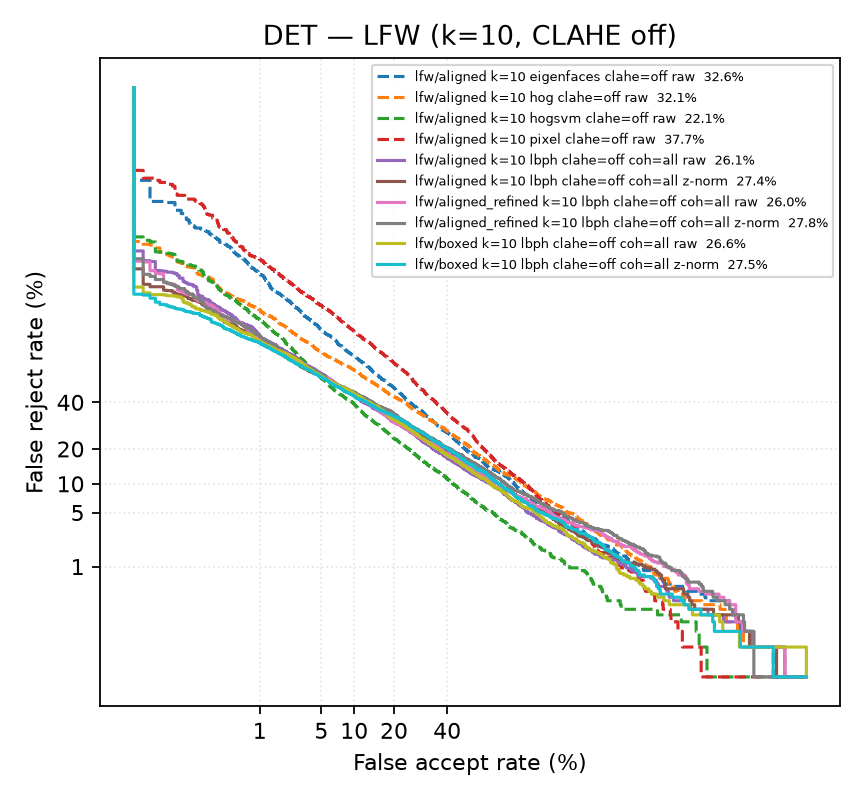
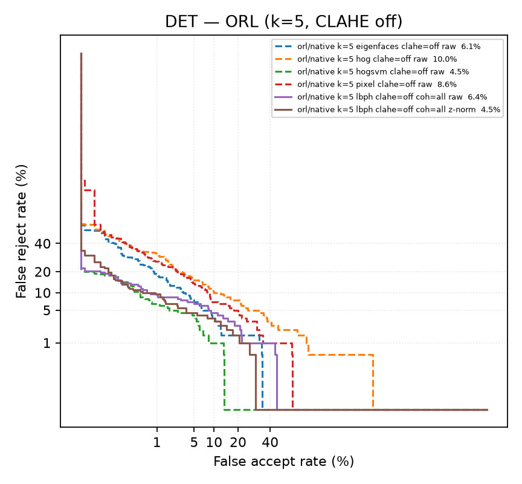
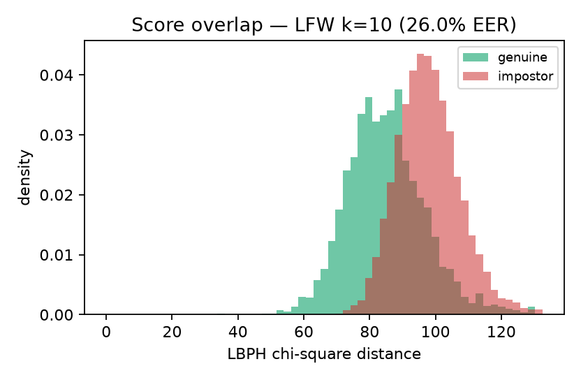
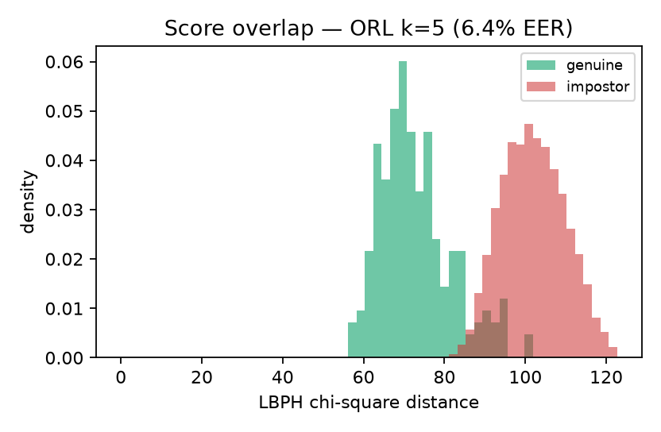

# Classical Face Authentication

[](https://github.com/LuiShek/classical-face-authentication/actions/workflows/tests.yml)
[](https://www.python.org/)
[](https://opencv.org/)
[](LICENSE)

A Windows-first, reproducible face authentication system built around **Local
Binary Patterns Histograms (LBPH)**. It provides interactive registration and
login, conservative per-user calibration, active head-turn liveness, encrypted
biometric storage, rate limiting, and benchmarked multi-frame scoring.

The identity matcher is classical and fully inspectable. YuNet is used only for
face detection and five-point landmarks; no neural face embedding is used for
identity comparison.

> [!IMPORTANT]
> This is an evaluated research and engineering system, not certified biometric
> access-control software. Read [Security and limitations](#security-and-limitations)
> before using it to protect sensitive resources.

<details>
<summary><b>Contents</b></summary>

- [Highlights](#highlights)
- [Measured results](#measured-results)
- [Figures](#figures)
- [Architecture](#architecture)
- [Requirements](#requirements)
- [Installation](#installation)
- [Usage](#usage)
- [Reproducing the evaluation](#reproducing-the-evaluation)
- [Project structure](#project-structure)
- [Security and limitations](#security-and-limitations)
- [Contributing](#contributing)
- [License](#license)

</details>

## Highlights

- **Interactive CLI:** first-run registration followed by Login / Register /
  List / Exit.
- **Classical identity matching:** one OpenCV LBPH model per registered user.
- **Three-frame login:** median pooling over temporally separated probes.
- **Active liveness:** stable neutral pose, randomized left/right turn, and
  return to center.
- **Conservative calibration:** thresholds target zero observed background-
  cohort false accepts, accepting additional false rejects.
- **Encrypted biometrics:** models, enrolment crops, and cohort crops use
  Windows DPAPI and are bound to the current Windows account.
- **Persistent lockout:** three failed logins trigger a 30-second lock; later
  failures double the delay up to 15 minutes.
- **Reproducible evaluation:** deterministic splits, identity-clustered
  bootstrap intervals, DET curves, baselines, and stored score artifacts.

## Measured results

### LBPH benchmark

| Dataset / configuration | EER | TAR at FAR=1% |
|---|---:|---:|
| ORL, native 92×112, 3 enrolment images | 12.14% | 82.14% |
| ORL, native 92×112, 5 enrolment images | 6.36% | 90.50% |
| ORL, native 92×112, 7 enrolment images | 5.83% | 94.17% |
| LFW aligned, 10 enrolment images | 26.09% | 28.01% |

### Three-frame median pooling

The paired arms use the same models and the same deterministic probe groups.

| Dataset | One frame | Median of three | TAR at FAR=1% |
|---|---:|---:|---:|
| ORL, k=5 (40 paired target groups) | 5.00% | **0.06%** | 87.50% → **100.00%** |
| LFW aligned, k=10 (779 paired target groups) | 26.83% | **18.74%** | 27.47% → **38.13%** |

The paired LFW 95% identity-clustered intervals are 24.23–28.42% for one
frame and 16.50–20.62% for median-of-three. ORL has only 40 pooled target
groups, so its near-zero result should not be interpreted as a deployment error
rate.

### Classical baselines

| Method | ORL k=7 | LFW k=10 |
|---|---:|---:|
| Raw-pixel cosine | 7.50% | 37.68% |
| HOG + cosine | 12.33% | 32.13% |
| Eigenfaces (PCA-50 + cosine) | 5.83% | 32.63% |
| HOG + LinearSVC pair classifier | **1.97%** | **22.14%** |
| LBPH, raw distance | 5.83% | 26.09% |

The supervised HOG classifier is an optimistic comparison because it learns
from enrolment pairs belonging to the evaluated identities. LBPH requires no
separate metric-training stage.

## Figures

Both pairs are generated by the committed evaluation scripts and are not
hand-drawn.

| | |
|---|---|
|  |  |
| Detection error tradeoff, LFW aligned | Detection error tradeoff, ORL native |
|  |  |
| Genuine and impostor score distributions, LFW aligned | Genuine and impostor score distributions, ORL native |

## Architecture

```text
camera
  │
  ├─► quality gate (face size, blur, ambiguity)
  ├─► YuNet detection + five landmarks
  ├─► similarity alignment to 112×112 grayscale
  ├─► active liveness challenge (Login only)
  ├─► LBPH distance on three spaced frames
  ├─► median pooling
  ├─► per-user conservative threshold
  └─► ACCEPT / REJECT + persistent lockout
```

Enrolment uses five spaced frames. Login requires a named profile; it does not
attempt open-set identification among all registered users.

## Requirements

- Windows 10 or 11
- x64 CPython 3.10 or newer
- Webcam for interactive Login
- Kaggle CLI authentication only when downloading LFW for benchmark/cohort use

OpenCV does not currently publish native Windows ARM64 wheels. Windows-on-ARM
systems must use an x64 Python interpreter under emulation.

## Installation

```powershell
git clone https://github.com/LuiShek/classical-face-authentication.git
cd classical-face-authentication

py -m venv "$env:LOCALAPPDATA\faceauth\venv"
$python = "$env:LOCALAPPDATA\faceauth\venv\Scripts\python.exe"

& $python -m pip install --upgrade pip
& $python -m pip install -r requirements.txt
& $python -m pip install -e . --no-deps
& $python -m faceauth.cli selftest
```

Activate the environment to expose the `faceauth` command in that PowerShell
window:

```powershell
& "$env:LOCALAPPDATA\faceauth\venv\Scripts\Activate.ps1"
faceauth
```

Alternatively, run the executable directly:

```powershell
& "$env:LOCALAPPDATA\faceauth\venv\Scripts\faceauth.exe"
```

## Usage

### Interactive workflow

On an empty installation, `faceauth` asks for a name, captures five spaced
enrolment frames, and offers an immediate Login. Later runs show:

```text
1. Login
2. Register another face
3. List users
4. Exit
```

Login always requires a live camera and the active liveness challenge. Offline
files are accepted only by the explicitly low-level `verify` command.

### Scriptable commands

```powershell
faceauth register                     # prompt for a name and enrol
faceauth register <name>              # enrol a named profile
faceauth login <name> --json          # live liveness + three-frame login
faceauth list
faceauth delete <name> --yes
faceauth selftest
```

Exit codes are stable for automation:

| Code | Meaning |
|---:|---|
| 0 | accepted / command succeeded |
| 1 | authentication rejected |
| 2 | operational error |

### Background cohort and calibration

Registration works without a background cohort, but false-accept performance is
then unmeasured. To prepare LFW, build the encrypted cohort, and recalibrate:

```powershell
$python = "$env:LOCALAPPDATA\faceauth\venv\Scripts\python.exe"
& $python scripts\prepare_data.py --dataset lfw
faceauth cohort build                 # 30 identities × 3 crops
faceauth cohort status
faceauth calibrate --all --target-far 0
```

The cohort is sampled deterministically from the prepared LFW cache. Its labels,
sampling parameters, and source-cache SHA-256 are recorded in metadata.

### Biometric storage

```powershell
faceauth secure status
faceauth secure migrate --all         # preview legacy plaintext migration
faceauth secure migrate --all --yes   # verify encryption, then remove plaintext
faceauth secure restore <name> --yes  # rollback while retaining ciphertext
```

Encrypted data lives outside the repository:

```text
%LOCALAPPDATA%\faceauth\faces\<profile>\model.yml.dpapi
%LOCALAPPDATA%\faceauth\faces\<profile>\crops.npz.dpapi
%LOCALAPPDATA%\faceauth\faces\<profile>\meta.json
%LOCALAPPDATA%\faceauth\cohort\background.npz.dpapi
```

`meta.json` contains calibration settings and counts, not face pixels or LBPH
histograms.

## Reproducing the evaluation

```powershell
$python = "$env:LOCALAPPDATA\faceauth\venv\Scripts\python.exe"

& $python scripts\prepare_data.py --dataset all --refine
& $python scripts\evaluate.py --dataset orl --k 7
& $python scripts\evaluate.py --dataset lfw --variant aligned --k 10
& $python scripts\evaluate_pooling.py --dataset lfw --variant aligned --k 10 --takes 1 3
& $python scripts\baselines.py --dataset orl --k 7 --method all
& $python scripts\summarise.py
```

Large datasets and biometric data never live in the checkout. They are stored
under `%LOCALAPPDATA%\faceauth\`.

## Project structure

```text
src/faceauth/       detector, preprocessing, LBPH, calibration, liveness,
                    encrypted storage, cohort, rate limiting, CLI
scripts/            data preparation, evaluation, baselines, report generation
tests/              deterministic unit and integration tests
docs/               methodology and protocol details
src/faceauth/assets/ committed YuNet and Haar assets (not biometric data)
outputs/            scalar score artifacts and reports (no face images)
figures/            DET curves and score distributions
```

See [docs/methodology.md](docs/methodology.md) for protocol construction,
ablation design, confidence intervals, data-source constraints, and detailed
limitations. See [ROADMAP.md](ROADMAP.md) for future research work.

## Security and limitations

- Active head-turn liveness rejects a stationary print, but it is not certified
  presentation-attack detection. An adaptive replay, articulated photograph, or
  mask may pass.
- Windows DPAPI protects copied files but not data accessed by malware already
  running as the signed-in user.
- The LFW background cohort is not webcam-domain matched. Zero observed cohort
  false accepts does not imply a real-world FAR of zero.
- Each live profile has only five leave-one-out genuine scores, so calibration
  uncertainty is substantial.
- ORL and LFW do not establish demographic fairness or deployment performance.
- LBPH is sensitive to pose, illumination, registration, and look-alikes.

For vulnerability reporting, see [SECURITY.md](SECURITY.md).

## Contributing

Contributions are welcome. Please read [CONTRIBUTING.md](CONTRIBUTING.md) and do
not attach biometric images, models, or enrolment crops to issues or pull
requests.

## License

Released under the [MIT License](LICENSE).
